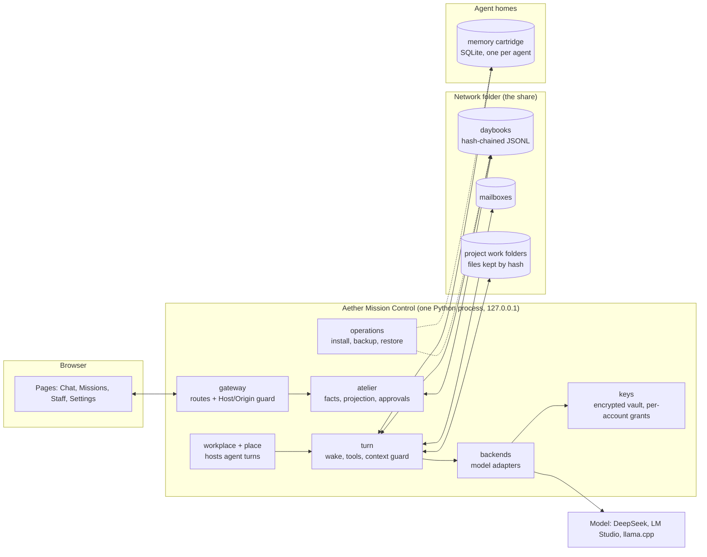

# Architecture

Aether is a local web application. One Python process serves the pages and runs a background worker (a *place*) that
wakes agents when they have unread notes. Each project's conversation is an append-only, hash-chained record (the
*daybook*) in a network folder. Each agent's memory is its own SQLite file.

## How a project runs

1. **The brief.** You open a project from **Missions**. The brief becomes the first note in a new daybook.
2. **Facts.** After every note, `aether/atelier/facts.py` re-reads the daybook and derives the plan, the team,
   approvals, deliverables and verdicts. Nothing is entered twice: the structure comes from what was written.
3. **Turns.** The place (`aether/atelier/place.py`) sees an agent with unread notes and runs a turn
   (`aether/atelier/turn.py`). The agent wakes with its identity, the headers of its memories and the unread notes.
   It can read and write files inside its allowed folders, run tests, look up and load its memories, and reply. The
   reply is appended to the daybook.
4. **Your decisions.** When the lead's plan is ready, the page asks you to **Approve the plan**. When the reviewer has
   passed the work and the lead says it is ready, it asks you to **Accept result**. The budget is counted per model
   call; reaching it stops the work.
5. **Closing.** On acceptance each agent files closing notes into its own cartridge
   (`aether/atelier/mind_memory.py` over `AetherMemory/memory_fabric/`). The next project's wake shows their headers.

## Where things live

| Package (`AetherAgents/LightweightAgents/Bridge/aether/`) | Responsibility |
|---|---|
| `mission_control/` | The HTTP server, the route table (`gateway.py`) and the Host/Origin guard on every route |
| `atelier/` | Projects as conversations: the daybook, facts, projection for the pages, turns, places, agent memory glue |
| `mailbox/` | Delivery of notes to agents |
| `backends/`, `models/` | Model adapters (DeepSeek and OpenAI-compatible servers) and connection profiles |
| `keys/` | The encrypted key vault, per-account usage grants and redaction |
| `library/`, `knowledge/` | Shared collections and the material lent to projects |
| `agent_editor/` | Authoring templates for new agents |
| `roadmaps/`, `campaign/` | Roadmap and sprint records shown on the Roadmaps pages |
| `data_sources/` | Optional external reporting services (MCP) |
| `operations/` | Installation, the launcher, backup, verify, restore and uninstall |
| `config/`, `integrity/`, `toolbelt/`, `memory/`, `agent/` | Settings, integrity checks, the calculator and tool belt, memory sessions, shared agent helpers |

`aether_bridge/` holds the web pages and short modules that keep older import paths working.
`AetherMemory/memory_fabric/` is the memory engine: storage, recall, links, fading and the read-only query layer.

## Design choices worth knowing

- **Structure after, not before.** Agents write ordinary prose. The plan, the roster and the verdicts are read out of
  what they wrote, and the page asks in the conversation when something is missing.
- **One record.** The daybook is the source of truth; pages are projections of it. Each line carries the hash of the
  one before. That makes the record self-consistent; to make edits detectable, keep its last hash somewhere else, as
  [VALIDATION.md](../VALIDATION.md) does for the October 28 run.
- **Memory is the agent's.** The agent decides what to file and what to read. Memory is never a gate: no step waits
  for an agent to acknowledge or clear its memory.
- **Few stops.** The Atelier halts only for money, consent, secrets and harm. Everything else is recorded and the work
  continues.
- **Local by default.** The server binds to 127.0.0.1, every state-changing request must come from the page's own
  origin, and keys are resolved per call for the account that started the work.
